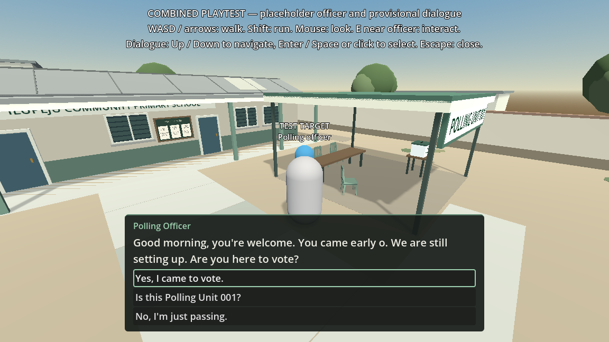

# Compact dialogue panel: courtyard review

**Date:** 12 October 2026. **Reviewer:** Claude. **Branch:** `feature/dialogue-layout` (uncommitted changes).

## Source baseline and tested versions

The branch was created from `origin/main` at `736127e3497f5ff2d7a1b3aaf855a4830d6cf9a0`, which equals local `main` and includes both feature merges (PR #1 and PR #2).

Layout files tested (Git blob hashes; unchanged since testing):

| File | Blob |
|---|---|
| `scenes/ui/dialogue_panel.tscn` | `ec3a314d92916846e8868c839ae79c01ebd8fc50` |
| `scripts/dialogue/dialogue_panel.gd` | `97ad16fead13cd3dd4f4a34330a21488f85f327e` |
| `docs/dialogue/DIALOGUE_PANEL.md` | `39a1d7b2e2cb819359be896bf23697a1325dbc7c` |

The combined scene exists only as uncommitted work in the integration worktree (`integration/interaction-dialogue` at `29f35dd4ba2a0a912c4c4fcf24ea322a611d1b6d`). With the owner's approval, the test ran in a temporary copy of that worktree with the three layout files above applied. The copy has since been deleted. Neither worktree was modified. Files used from the integration worktree:

| File | Blob | State |
|---|---|---|
| `tests/integration/interaction_dialogue_playtest.tscn` | `550f9cce6d85a774c9b12303c0d48433ce971fa5` | untracked |
| `tests/integration/run_integration_checks.gd` | `dec2939912aacb77cd4abede16748bf785e62e6c` | untracked |
| `project.godot` | `02fa74f8dc6e988f14a91ff8488bba6f4a13b254` | modified (same key bindings, re-serialised) |
| `scripts/interaction/interaction_controller.gd` | `7a7227c57eacd6daf3d6aca5f5775677cb293462` | committed |
| `data/dialogue/polling_officer_intro.json` | `0d85c0bc5212bc62ecc85f7435faac9dc5bc0b41` | committed |

Engine: Godot `4.7.2.stable.official.ed1daf0bf`, Compatibility renderer, X11 display.

## Results

| Check | Result |
|---|---|
| Readability against the courtyard at 1152 × 648, 1920 × 1080, 800 × 600 and 640 × 360 | Readable at every size. The officer and canopy stay visible above the box |
| Mouse: real click on "Is this Polling Unit 001?" | `response_selected(greeting, ask_unit)` once, then the next line shown. Mouse visible during dialogue |
| Keyboard: Down, then Enter | Focus moved to `Response_ask_unit`. Same single selection |
| Scrolling: ten-choice layout sample (`tests/dialogue/preview/layout_many.json`) at 640 × 360 | Mouse wheel scrolled the list 0 → 97 px. The list stays inside the box |
| Dialogue suite | 50 of 50 passed |
| Combined suite, headless | 315 checks, 0 failures |
| Combined suite, display-backed | 347 checks, 0 failures, 3 captured-mouse scenarios |

These are synthetic inputs and screenshots. A human playtest is still needed to judge comfort.

### Why 347 here and 348 in the integration handoff

`run_integration_checks.gd` runs exactly one extra check, "optional rendered preview saved", only when a display is present and `--snapshot=<path>` is passed. The integration handoff states that its 348-check run included the optional preview export. This run did not pass `--snapshot`, which accounts for the one-check difference. The original log of the 348-check run is no longer available, so this explanation rests on the script and the handoff, not on a log comparison.

## Remaining small-window issues

1. **Small text on small windows.** At 640 × 360 the dialogue text renders at about 11 physical pixels. The project's `canvas_items` stretch scales all interface elements with the window; the panel's font sizes are unchanged. This predates the layout change. A fix would be a project display setting, which is shared configuration owned by Codex.
2. **Long lists.** Ten choices plus a long line can make the box about 58% of the screen height at 640 × 360. The real conversation never comes close.
3. **Player capsule hidden.** At small sizes the box covers the player capsule at the bottom of the screen. This depends on camera framing (Codex's area).

## Reproducing

See `tests/dialogue/preview/README.md`. Other screenshots and the PDF summary from this review are kept locally under `docs/previews/` and are ignored by Git (`docs/previews/.gitignore`).
